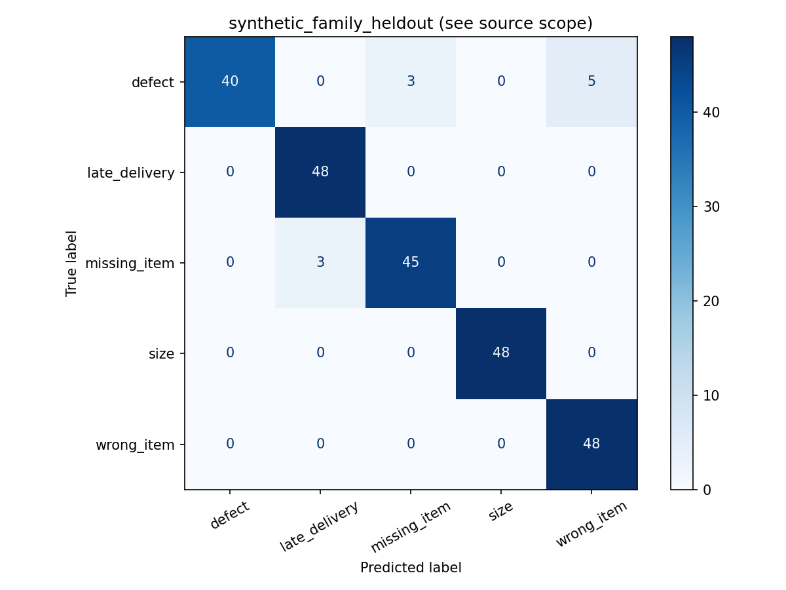
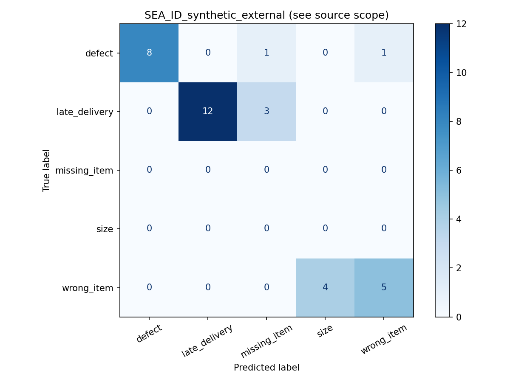
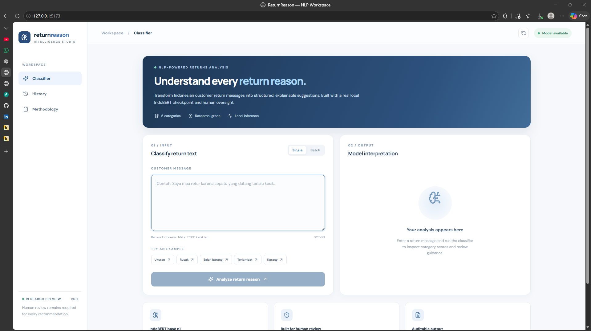

# ReturnReason Classifier

**Day 19 / 100 Days of Projects · Indonesian NLP research prototype**

[Repository](https://github.com/MENSTRUE/ReturnReason-Classifier) · [Indonesian documentation](docs/id/README.md) · [English documentation](docs/en/README.md) · [Agent instructions](AGENTS.md)

> **Research prototype, not a production returns decision engine.** This project runs a real, local IndoBERT classifier for five Indonesian e-commerce return reasons. Its training/evaluation evidence is predominantly synthetic or proxy-labelled. Human confirmation is required for **every** suggestion. Scores are **uncalibrated softmax outputs**, not probabilities of correctness.

## 1. Why this exists

Customer-return messages are messy: short, colloquial, ambiguous, negated, multi-intent and occasionally unrelated to returns. This project investigates a human-assisted NLP workflow that turns one message into a *suggested* return-reason category, exposes all five model scores, and preserves a manual review boundary. The goal is a working research integration and a reproducible evidence trail—not autonomous refund approval, fraud detection, or verified real-world classification accuracy.

## 2. Before → Now → Next

| Phase | Evidence-based status |
|---|---|
| **Before** | Unstructured Indonesian return messages; dataset suitability and label provenance unresolved. |
| **Now** | IndoBERT checkpoint trained in the project workflow; FastAPI single/batch inference; React UI with scores and review notices; synthetic and small external diagnostic reports; local backend tests. |
| **Next** | Collect independently human-annotated, consented Indonesian return complaints; audit taxonomy; add out-of-scope rejection, negation/multi-intent handling, calibration and a production security/deployment plan. |

**Current maturity:** functional local demonstration / research preview. **Not demonstrated:** reliable handling of real customers, business automation, or deployment readiness.

## 3. Architecture and inference contract

```text
User message (Indonesian)
    → React + TypeScript + Vite UI
    → FastAPI POST /predict or POST /batch
    → tokenizer from local models/indobert/
    → IndoBERT sequence classifier (PyTorch, eval/inference mode)
    → five softmax scores + highest-scoring class
    → provisional REVIEW/SUGGESTED routing
    → human verification (required in both cases)
```

Model: `indobenchmark/indobert-base-p1`; configured tokenizer truncation `RRC_MAX_LENGTH=192`. A local compatible `model.safetensors` must be supplied; the Git repository includes config/tokenizer metadata, **not the weights**. The backend requires an exact five-class label mapping and rejects inconsistent checkpoints. The `SUGGESTED` flag means only that the top score met a **provisional** threshold (default `0.65`); it does **not** mean approved, verified, or safe to automate.

### Label ontology

| Machine label | Indonesian display | Typical intent |
|---|---|---|
| `defect` | Produk rusak | Damage / malfunction |
| `wrong_item` | Barang tidak sesuai | Incorrect item or variant |
| `missing_item` | Barang kurang | Missing quantity / component |
| `late_delivery` | Pengiriman terlambat | Delayed delivery |
| `size` | Masalah ukuran | Size/fit problem |

**Taxonomy limitation:** a single-label classifier cannot faithfully represent multiple simultaneous issues; there is no learned `other`, `unknown`, `not-a-return`, or abstention class. Avoid mapping any arbitrary message to a valid category without human checking.

## 4. Dataset provenance — do not conflate source size with training size

Dataset root recorded by the experiment: `/kaggle/input/datasets/wafabila/returnreason-classifier-multi-source-dataset/`.

| Source in `reports/final_summary.json` | Kaggle subpath | Source rows | Role and boundary |
|---|---|---:|---|
| Bitext Retail E-commerce LLM Chatbot Training Dataset | `bitext-retail/bitext-retail-ecommerce-llm-chatbot-training-dataset.csv` | 44,884 | Source pool; **3,629 proxy training rows** recorded, not 44,884 gold return annotations |
| Ecommerce Return Abuse Dataset | `ecommerce-returns/ecommerce_return_abuse_dataset.csv` | 60,000 | Inspected/source inventory; **not** used as self-labelled text training for return reasons |
| Return Reasons ID / SEA | `return-reasons-id/data.csv` | 1,000 | Source pool; **34 external diagnostic rows** recorded; not an independent human-verified gold benchmark |
| Authored synthetic complaint templates | Generated in notebook | 1,200 | Primary synthetic experiment: 840 train, 120 validation, 240 held-out test |

The Kaggle *input path* identifies the dataset bundle used; it does not establish the original publisher, upstream URL, license or permission to redistribute the source files. Before external redistribution, trace each source to its original publisher and verify its terms. Source row counts are **not** total train counts and should never be added up to claim 105,884 annotated return complaints.

### Synthetic generation contract

`reports/synthetic_generation_contract.json` records **50 manually authored semantic templates**, programmatic variation of item names/endings, `seed=42`, **10 template families per class**, 1,200 generated rows, and five classes. A family-aware holdout reduces direct template-family leakage, but lexical overlap and synthetic style remain. Template labels are not independent human judgments.

### Data quality and leakage policy

- Separate source, annotation provenance, language and use (train/validation/test/external diagnostic).
- Never infer a valid gold label from a filename, model prediction, keyword or return-abuse field without independent verification.
- Prevent exact/near-duplicate and template-family overlap; preserve immutable test partitions.
- Log class support and label provenance. Preserve negation, misspellings, Indonesian slang, mixed intents and out-of-scope cases in a future human test set.
- Keep private customer data, personally identifiable information and raw licensed datasets out of Git.

## 5. Evaluation — source-of-truth metrics

**Authoritative artifacts:** `reports/final_summary.json`, `reports/synthetic_family_heldout_metrics.json`, `reports/SEA_ID_synthetic_external_metrics.json`, `reports/model_comparison.csv`, `reports/indobert_training_history.csv`, and confusion matrices under `assets/plots/`.

| Split | N | Accuracy | Macro-F1 (five-class) | Interpretation |
|---|---:|---:|---:|---|
| Synthetic family held-out | 240 | **95.42%** | **0.9534** | Measures performance on synthetic, family-separated examples only |
| SEA-ID synthetic external diagnostic | 34 | **73.53%** | **0.4889** | Small proxy-labelled diagnostic; only three classes present |
| Independently human-verified real customer gold | **0** | **Unavailable** | **Unavailable** | No supported real-world accuracy claim |

External support: `late_delivery=15`, `defect=10`, `wrong_item=9`, `missing_item=0`, `size=0`. Its five-class macro-F1 includes the absent classes as zeros; the external test cannot establish quality on `missing_item` or `size`. The training status report records a completed **3-epoch** IndoBERT run and a validation macro-F1 of `1.0`, but that is not an independent production benchmark.

### Visual evaluation assets (already tracked)

**Synthetic family-heldout confusion matrix**



**SEA-ID external diagnostic confusion matrix**



### Exploratory UI/manual challenge cases (not a benchmark)

Manual screenshot inspection demonstrates the following failure patterns; these are qualitative examples, not a representative sample or a calibrated error rate:

| Message | Observed UI prediction | Concern |
|---|---|---|
| `Barang yang saya terima pecah dan tidak bisa digunakan.` | Barang kurang, 57.6% | Damage confused with missing item |
| `Saya membeli tiga produk, tetapi yang datang hanya dua.` | Barang tidak sesuai, 80.8% | Missing quantity confused with wrong item |
| `Ukuran sudah sesuai, tetapi resleting jaketnya rusak.` | Masalah ukuran, 94.5% | Negation ignored, damage missed |
| `Barangnya bagus dan tidak rusak, hanya terlalu besar.` | Produk rusak, 92.7% | Negated defect falsely dominates |
| `Saya memesan dua kaos ukuran L. Yang datang satu kaos ukuran M.` | Masalah ukuran, 65.6% | Multiple reasons; single-label limitation |
| `Halo, apakah toko masih buka?` | Barang kurang, 82.0% | Out-of-scope message forced into taxonomy |
| `Barang rusak, ukurannya salah, dan pengiriman terlambat.` | Produk rusak, 64.3% | Multiple valid intents collapsed |

**Do not** use a high softmax score as evidence that these predictions are correct. **Do not** advertise a 95% customer-service accuracy rate.

## 6. Product UI and screenshot assets

The current `assets/screenshots/` directory contains **only `.gitkeep`**. The user has captured screenshots in the project discussion, but they have **not yet been committed to this folder**. Therefore the README deliberately avoids broken image embeds. Recommended filenames to add after exporting/copying actual screenshots:

```text
assets/screenshots/
  01-classifier-overview.png
  02-defect-misclassified-as-missing.png
  03-missing-misclassified-as-wrong-item.png
  04-negation-size-vs-defect.png
  05-negation-defect-vs-size.png
  06-mixed-missing-and-size.png
  07-out-of-scope-question.png
  08-multiple-return-reasons.png
```

The UI includes a sidebar (Classifier, History, Methodology), model-availability indicator, single/batch switch, text input, sample prompts, prediction output, per-class score bars, a research warning and export affordance. **History is browser-session scoped**, not a durable customer-case database. Before sharing screenshots, redact private text and ensure each caption clearly states whether it shows a correct example or a failure case.

## 7. Actual repository layout (verified on GitHub)

```text
ReturnReason-Classifier/
├── .env.example
├── .gitignore
├── AGENTS.md                       # agent instructions / governance
├── LICENSE                         # MIT for repository code
├── README.md                       # project entry point
├── assets/
│   ├── plots/
│   │   ├── SEA_ID_synthetic_external_confusion_matrix.png
│   │   └── synthetic_family_heldout_confusion_matrix.png
│   └── screenshots/.gitkeep        # screenshots not committed yet
├── backend/
│   ├── README.md
│   ├── requirements.txt
│   ├── app/
│   │   ├── main.py
│   │   ├── api/routes.py
│   │   ├── core/settings.py
│   │   ├── schemas/prediction.py
│   │   └── services/classifier.py
│   └── tests/test_api.py
├── data/{raw,interim,processed}/   # placeholders, not published datasets
├── docs/{id,en}/README.md         # documentation placeholders
├── exports/
│   ├── demo_predictions.csv
│   └── real_return_annotations_TEMPLATE.csv
├── frontend/
│   ├── .env.example
│   ├── README.md
│   ├── package.json
│   ├── index.html
│   ├── public/.gitkeep
│   ├── src/{App.tsx,main.tsx,styles.css}
│   ├── tsconfig.json
│   └── vite.config.ts
├── ml/{data,evaluation,features,inference,training}/ # scaffolding
├── models/
│   ├── model_config.json
│   └── indobert/{config.json,tokenizer.json,tokenizer_config.json}
├── notebooks/returnreason-classifier.ipynb
├── reports/
│   ├── final_summary.json
│   ├── indobert_status.json
│   ├── indobert_training_history.csv
│   ├── model_comparison.csv
│   ├── release_checksums.json
│   ├── split_class_counts.csv
│   ├── synthetic_generation_contract.json
│   ├── synthetic_family_heldout_metrics.json
│   └── SEA_ID_synthetic_external_metrics.json
├── scripts/.gitkeep
└── tests/__init__.py
```

**Do not present scaffolding as implemented ML modules.** Several folders and documentation files are intentionally empty at the inspected revision. The executable training experiment lives in `notebooks/returnreason-classifier.ipynb`; serving code lives in `backend/app/`.

## 8. Run locally (Windows PowerShell or shell)

Prerequisites: Python 3.11 recommended, Node.js/npm, available RAM for local IndoBERT inference, and the exact compatible trained checkpoint from the experiment.

```powershell
git clone https://github.com/MENSTRUE/ReturnReason-Classifier.git
cd ReturnReason-Classifier
python -m venv .venv
.\.venv\Scripts\Activate.ps1
python -m pip install -r backend/requirements.txt
```

Place the trained weights at `models/indobert/model.safetensors`. **This file is not on GitHub**. Ensure tokenizer/config and class ordering belong to the same checkpoint. Do not replace it with a generic pretrained IndoBERT weight file: generic weights do not contain this task's trained head.

Start backend from the repository root:

```powershell
python -m uvicorn backend.app.main:app --reload
```

If module imports fail due to package layout, use the backend working directory (the tested import convention in source):

```powershell
cd backend
python -m uvicorn app.main:app --reload
```

In another terminal:

```powershell
cd frontend
npm install
npm run dev
```

UI: `http://127.0.0.1:5173`; backend API documentation: `http://127.0.0.1:8000/docs`. `frontend/.env.example` contains the API base URL setting; copy to `.env` if needed. Backend CORS currently allows localhost and 127.0.0.1 port 5173. Check `/health` to distinguish availability from actual successful model loading.

### API quick check

```powershell
Invoke-RestMethod http://127.0.0.1:8000/health
Invoke-RestMethod -Method Post -Uri http://127.0.0.1:8000/predict -ContentType 'application/json' -Body '{"text":"Sepatu ini kekecilan, ukurannya tidak sesuai."}'
```

Routes are `/health`, `/predict`, `/batch`. Single-message input is nonblank and capped at 2,500 characters by schema; batch limit is 20. Response contains `predicted_reason`, `score`, `scores`, `decision`, `manual_review_required=true`, `confidence_is_calibrated=false` and a disclaimer. HTTP `503` indicates unavailable model artifacts, not a fallback dummy prediction.

## 9. Testing and reproducibility

```powershell
cd backend
python -m pytest tests -q
```

The project previously reported **7 backend tests passed**. This is historical evidence, **not a fresh CI run** for the current documentation update. To check frontend compile/build:

```powershell
cd frontend
npm install
npm run build
```

**Reproduction checklist:** record the Git commit SHA, Kaggle notebook version, source dataset bundle/version and licenses, synthetic seed 42, train/validation/test split definitions, preprocessing/tokenizer and class order, dependency versions, training configuration, checkpoint hash, evaluation reports, confusion matrices, and hardware. `reports/release_checksums.json` is an existing manifest, not proof that a newly downloaded checkpoint matches until hashes are independently verified. Without the private/excluded dataset inputs and model weights, this repository supports **partial**, not one-command exact end-to-end reproduction.

## 10. Deployment posture and security

This is a **local demo**, not a hardened hosted service. Before any deployment: enforce authentication, request size/rate limits, controlled CORS, TLS, structured logging without customer text, secrets management, model artifact integrity checks, resource quotas, security scanning, dependency pinning, privacy retention/deletion rules, abuse tests, monitoring, and human escalation. Do not accept public user text as permission to collect, train on or retain personal data. Do not connect predictions directly to refunds or seller penalties.

## 11. Troubleshooting

| Symptom | Likely cause | Action |
|---|---|---|
| `/health` reports `model_available=false` | Missing weights/config | Supply matching `models/indobert/model.safetensors`; verify `RRC_MODEL_DIR` |
| `/predict` returns 503 | Model files/import/dependency unavailable | Inspect backend traceback and model path; do not fake output |
| Label mismatch error | Different checkpoint/class ordering | Compare checkpoint `id2label`, `models/model_config.json`, notebook mapping |
| CORS / failed fetch in UI | Backend down, URL or origin mismatch | Start API, verify `frontend/.env`, localhost:5173 allowed origins |
| `ModuleNotFoundError: app` | Wrong working directory | `cd backend` then `python -m uvicorn app.main:app --reload` |
| Frontend won't start | Missing npm dependencies | `cd frontend; npm install; npm run dev` |
| High score but wrong result | Synthetic bias / no calibration / closed taxonomy | Treat as suggestion, collect human annotation; do not change threshold and claim solved |
| OOM or slow first inference | CPU memory / model initialization | Use appropriate hardware, monitor memory; avoid public deployment without profiling |
| README screenshot missing | Screenshots not tracked | Add real PNGs to `assets/screenshots/`; do not link `.gitkeep` |

## 12. Roadmap

- **P0 — evidence:** independently annotated Indonesian gold set with provenance, inter-annotator agreement, sufficient per-class support and out-of-scope examples; baseline/transformer comparison; error slices for negation and multi-intent.
- **P1 — model:** refine taxonomy, optional multi-label formulation, trained rejection/other class, probability calibration, threshold tuning on held-out human labels, robustness tests.
- **P2 — product:** explicit reviewer correction workflow, privacy-safe history, feedback export, batch progress/error states, accessible mobile layout, E2E UI tests.
- **P3 — release:** repeatable environment/lockfiles, CI, artifact registry, model card/data cards, containerization, monitoring, threat modeling, deployment approvals.

## 13. Claim boundaries (copy into demos, portfolio and posts)

**Allowed:** “Built a working React + FastAPI application running local IndoBERT inference on Indonesian return text.” “Evaluated synthetic family-heldout and small external proxy diagnostic sets.” “The interface exposes scores and requires human confirmation.”

**Not allowed:** “95% accurate on real customer complaints”; “validated production AI”; “automatically determines correct return reason”; “high confidence means correct”; “detects fraud”; “supports any return reason”; “all 105,884 source rows were gold-labelled training examples.”

Suggested one-line disclaimer: **“Day 19 research prototype: real IndoBERT inference, synthetic/proxy-labelled evaluation, known negation and out-of-scope failures; all outputs require human review.”**

## 14. FAQ

**Is this a fake AI demo?** No: the backend loads a local Hugging Face IndoBERT sequence classifier and executes inference; the model weights are not included in the Git repository.

**Why does a 95.42% test score coexist with obvious errors?** The 95.42% figure is on a controlled synthetic holdout. Manual natural-language probes differ in distribution and include negation, multiple issues and out-of-scope inputs.

**Can it recognize “other”?** No. `OTHER` is not trained; routing thresholds are only provisional review flags.

**Can I deploy it publicly?** Not responsibly without real-world validation, privacy/security work and operational controls.

**Can I reproduce exact predictions by cloning?** Not without the compatible checkpoint; exact retraining also needs original data access and environment details.

**Does “History” mean server-side storage?** No; the current demo's history is scoped to the browser session.

**Can it approve returns automatically?** No. It provides a suggestion for human confirmation only.

**Are source datasets redistributed here?** No. Data folders are placeholders; source access and licensing need independent verification.

## 15. License and attribution

The repository contains an **MIT LICENSE** for original code (copyright 2026 Wafa Bila Syaefurokhman). That license does **not** automatically relicense third-party datasets, pretrained IndoBERT weights, tokenizer artifacts, or any screenshot containing third-party/customer material. Review each upstream license and usage conditions before redistribution or commercial use. Attribute IndoBERT and dataset publishers using their verified primary sources; do not invent upstream links.

## 16. Maintainer and source-of-truth policy

Maintained as a learning/research portfolio project in the 100 Days of Projects series. For future updates, read **`AGENTS.md`** first. The hierarchy of evidence is: actual code and tracked files → machine-generated `reports/*.json` / plots → executed notebook → dated test logs → README narrative. When they disagree, investigate rather than silently editing the metrics. Preserve failed examples and known limitations. No metric, file, model capability or successful test may be claimed without corresponding evidence.


## Bilingual documentation pack and visual evidence

For dedicated topic documents, start at [docs/README.md](docs/README.md), [Bahasa Indonesia](docs/id/README.md), or [English](docs/en/README.md). Both languages cover architecture, dataset provenance, evaluation, claim boundaries, reproducibility, deployment, roadmap, and troubleshooting/FAQ.

The screenshots in [assets/screenshots/](assets/screenshots/) are manual UI observations, **not** a customer test set. See [screenshot evidence index](assets/screenshots/README.md).



Experimental plots committed in the existing repository:


